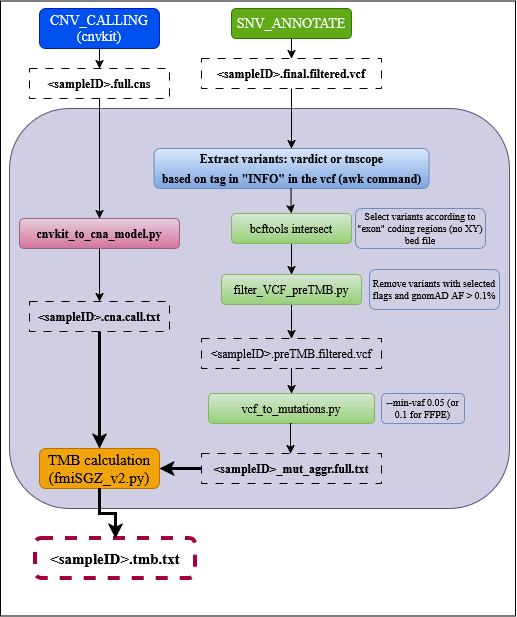

# Tumor mutational Burden (TMB) using SGZ tool
LAST UPDATES 2026/11/17

Following the approach of Foundation Medicine Inc https://link.springer.com/article/10.1186/s13073-017-0424-2
"TMB was defined as the number of somatic, coding, base substitution, and indel mutations per megabase of genome examined."

The original scripts for SGZ (Somatic/Germline Zygosity Classifiers) tool can be found here https://github.com/FoundationMedicineInc/SGZ. It classifies short variants (SNVs and small indels) detected by targeted next-generation sequencing as somatic or germline, before  computing Tumor Mutation Burden (TMB). Additional scripts were developped for the CMD needs: cnvkit_to_cna_model.py, vcf_to_mutations.py, filter_VCF_preTMB.py and fixed some bugs in fmiSGZ.py, creating fmiSGZ_v2.py. Branched there: https://github.com/SMD-Bioinformatics-Lund/SGZ/tree/SMD.

The original script fmiSGZ.py was developped by SGZ https://github.com/SMD-Bioinformatics-Lund/SGZ


## Overview

### - **VCF** |
The final.filtered vcf (from snv_annotate) of the Somatic Panel Pipeline is processed as follow:

   1) EXTRACTION of variants for the caller of choice (TNscope, VARDICT..)
   2) FILTERING to:
        - keep variants only in the coding regions of the genes of interest (corresponding to exons probe, coding, no X or Y chromosomes)
        - remove variants:
            1. with warnings ("FAIL*,*PON*,WARN_MQ,Q10,GERMLINE*,p8,pSTD,WARN_LOW_TCOV,*HOMOPOLYMER*,NM5.25,WARN_STRANDBIAS,t_lod_fstar,triallelic_site")
            2. likely germline variants (gnomAD > 0.1%, removing also the rare germline variants)
            3. if VAF < 5% (10% if FFPE samples)
   3) CONVERTED into a compatible table for TMB calculation using SGZ tool

### **Copy number segments** | 

Segments from CNVKit are also used for TMB, after their conversion into an SGZ-compatible table.
The tumor purity is also required.


### Overview of the steps:




```
  1-VCF  
                  <sample>.final.filtered.vcf
                        ↓ 
                        ↓ [extraction of 1 caller variants]
                        ↓
            <sample>.final.filtered_<caller>.vcf
                        ↓ 
                        ↓ [bedtools intersect] using appropriate panel bed file 
                        ↓
            <sample>.final.filtered_<caller>.pool1_coding.vcf
                        ↓
                        ↓ [filter_VCF_preTMB.py]
                        ↓  (gnomAD AF < 0.001 & no "FAIL*,*PON*,WARN_MQ,Q10,GERMLINE*,p8,pSTD,WARN_LOW_TCOV,*HOMOPOLYMER*,NM5.25,WARN_STRANDBIAS,t_lod_fstar,triallelic_site")
                        ↓
            <sample>.final.filtered_vardict.pool1_coding_filtTMB.vcf
                        ↓  
                        ↓ [3_vcf_to_mutations.py]
                        ↓
            <sample>_*_mut_aggr.full.txt


2 - cnvkit segments (.full.cns) + purity value
            ↓
            ↓ [cnvkit_to_cna_model.py]
            ↓
      <sample>.cna.call.txt


3 - TMB calculation

         <sample>_*_mut_aggr.full.txt + <sample>.cna.call.txt
                                         ↓ 
                                         ↓ [fmiSGZ_v2.py]
                                         ↓
                  <sample>.fmi.sgz.txt / .fmi.sgz.full.txt / .tmb.txt
```

## Processing the VCF

### 1 - extract one caller variants
Use of the 8th column of the vcf where the caller is indicated

The caller to be used for variants extraction is specified in the config file under params.extraction_type. All variants called by the selected variants are extracted.
```
awk -v pattern="${params.extraction_type}" '/^#/ || $8 ~ "^[^;]*" pattern "[^;]*"' "${vcf}" \
            > "${prefix}.final.filtered_${params.extraction_type}.vcf"
```
### 2 - bedtools intersect
Following the method of the FoundationOne, we filter the variants for the coding regions of pool1 (exons of interest). Of note, vcf_to_mutations.py also filters variants based on the selection of the respective protein_coding transcripts
```
# Example for solid samples

BED_POOL1="/fs1/resources/ref/hg38/bed/twist-st/pool1_padded20bp.coding.sort.merge.bed"
BEDTOOLS_SIF="/fs1/resources/containers/bedtools-2.31.1.sif"
singularity exec -B /fs1 $BEDTOOLS_SIF \
        bedtools intersect -header -u \
        -a ${vcf_extracted_variants} \
        -b ${params.tmb_regions} \
        > ${prefix}.final.filtered_${params.extraction_type}_pool1coding.vcf
```
### 3 -  filter_VCF_preTMB.py
```
python3 filter_VCF_preTMB.py \
        --vcf "$vcf" \
        --output "$OUTPUT_DIR/${basename}_filtTMB.vcf" \
        --max_freq 0.001  \
        --filters "FAIL*,*PON*,WARN_MQ,Q10,GERMLINE*,p8,pSTD,WARN_LOW_TCOV,*HOMOPOLYMER*,NM5.25,WARN_STRANDBIAS,t_lod_fstar,triallelic_site"
```

### 4 - vcf_to_mutations.py
FoundationOne algo (FDA), Inst Curie algo (pyTMB) and old work from Vitkor on TMB chose VAF >= 0.05 (5%). For FFPE samples, pyTMB uses a cut-off at 0.1 (10%). Here, both of these cut-offs are chosen.
- FDA FO algorithm:
https://www.accessdata.fda.gov/cdrh_docs/pdf17/P170019S016B.pdf
- pyTMB:
https://link.springer.com/article/10.1186/s12915-024-01839-8


```
PYTHON_SIF="/fs1/resources/containers/pysam-numpy-pandas-scipy-py312.sif"
SCRIPT="vcf_to_mutations.py"
singularity exec -B /fs1 "${PYTHON_SIF}" python3 "${SCRIPT}" \
        "$file" \
        --min-vaf 0.05 \
        --sample "$sampleID" \
        --output "${OUTPUT_DIR}/${sampleID}_pool1_filtTMB_mut_aggr.full.txt"
```

## Processing the CNV segments

Either segments from CNVkit or GATK can be used. Comparison of the segments from the two tools for solid samples in the Somatic Panel Pipeline was performed and better TMB scores (fitting the expected TMB categories of the test samples) were obtained for using CNVkit segments (already published by the SPP), and thus used here for the TMB.
cnvkit_to_cna_model.py is therefore used for converting the .cns output from CNVkit into the compatible file for TMB, .cna.call.txt 

## TMB calculation
To calculate the TMB per megabase, the total number of mutations counted is divided by the size of the coding region of the targeted territory.

The panel size used for the TMB is to be evaluated.
### 1) PANEL SIZE

#### A - SOLID SAMPLES

- Original bed :/fs1/resources/ref/hg38/bed/twist-st/pool1_probes.solid.bed
```
# CALCULATE SIZE
awk '{s+=$3-$2} END {printf "%d bp\t%.3f Mb\n", s, s/1e6}' /fs1/resources/ref/hg38/bed/twist-st/pool1_probes.solid.bed
1949498 bp      1.949 Mb

# SORT ORIGINAL BED
sort -k1,1 -k2,2n /fs1/resources/ref/hg38/bed/twist-st/pool1_probes.solid.bed > pool1_probes.solid.sorted.bed
```

- Generate BED file from gencode annotation file, selecting all regions

```
BEDTOOLS="/fs1/resources/containers/bedtools-2.31.1.sif"

awk -F'\t' '{print $1"\t"$4-1"\t"$5}' /fs1/resources/ref/hg38/annotation_dbs/gencode.v38.annotation_exons_nochr.gtf | sort -k1,1 -k2,2n | singularity exec -B /fs1 $BEDTOOLS bedtools merge -i - > gencodev38_exons_nochr_merged.bed
```

- INTERSECT WITH CODING REGIONS OF THE ANNOTATION FILE
```
singularity exec -B /fs1 $BEDTOOLS bedtools intersect -a pool1_probes.solid.sorted.bed -b /fs1/resources/ref/hg38/annotation_dbs/gencodev38_exons_nochr_merged.bed | sort -k1,1 -k2,2n | singularity exec -B /fs1 $BEDTOOLS bedtools merge -i - > pool1_probes.solid.sorted.coding.merge.bed
```

As the script fmiGSZ_v2.py excludes chrX,Y, we also remove those regions, to get the proper panel size
```
# REMOVE X and Y REGIONS
awk -F '\t' 'BEGIN {OFS="\t"} $1 != "X" && $1 != "Y" {print $0}' pool1_probes.solid.sorted.coding.merge.bed > pool1_probes.solid.sorted.coding.merge.noXY.bed

# CALCULATE SIZE
awk '{s+=$3-$2} END {printf "%d bp\t%.3f Mb\n", s, s/1e6}' pool1_probes.solid.sorted.coding.merge.noXY.bed
1461526 bp      1.462 Mb

=> # use of panel-size 1.46 Mb at the fmiSGZ_v2.py step
```

#### B - HEMATO SAMPLES

- EXONS + CNV REGIONS : existing bed file
```
awk '{s+=$3-$2} END {printf "%d bp\t%.3f Mb\n", s, s/1e6}' /fs1/resources/ref/hg38/bed/GMSHem/HemGenePanelV1-1_TE-92467229_RUNX1-introns_0p04X_TE-97551470_hg38_nochr.bed
1812137 bp      1.812 Mb
```
- REGION CNV backbone
```
awk '{s+=$3-$2} END {printf "%d bp\t%.3f Mb\n", s, s/1e6}' /fs1/resources/ref/hg38/bed/GMSHem/HemGenePanelV1-1_TE-92467229_CNV_probes_nochr.sorted.bed
386229 bp       0.386 Mb
```
=> We want the bed file corresponding to the "exons" targeted regions only

##### 1. Create the bed file corresponding to pool1 coding (exons)

- Substract [EXONS + CNV REGIONS].bed with [CNV backbone].bed to get "regions exons"

```
module load singularity/3.8.0
BEDTOOLS="/fs1/resources/containers/bedtools-2.31.1.sif"

# SORT INITIAL BED
sort -k1,1 -k2,2n /fs1/resources/ref/hg38/bed/GMSHem/HemGenePanelV1-1_TE-92467229_RUNX1-introns_0p04X_TE-97551470_hg38_nochr.bed > HemGenePanelV1-1_TE-92467229_RUNX1-introns_0p04X_TE-97551470_hg38_nochr_sorted.bed

# REMOVE REGIONS OF THE CNV PROBES
singularity exec -B /fs1 $BEDTOOLS \
        bedtools subtract \
        -a HemGenePanelV1-1_TE-92467229_RUNX1-introns_0p04X_TE-97551470_hg38_nochr_sorted.bed \
        -b /fs1/resources/ref/hg38/bed/GMSHem/HemGenePanelV1-1_TE-92467229_CNV_probes_nochr.sorted.bed \
        > HemGenePanelV1-1_TE-92467229_RUNX1-introns_0p04X_TE-97551470_hg38_nochr_sorted_noCNVprobes.bed

# CALCULATE SIZE
awk '{s+=$3-$2} END {printf "%d\n", s}' HemGenePanelV1-1_TE-92467229_RUNX1-introns_0p04X_TE-97551470_hg38_nochr_sorted_noCNVprobes.bed
1425908
```


- Filter the "regions exons" with gencodev38_exons_nochr.merged.bed to get only the coding region
This is how the solid bed file /fs1/resources/ref/hg38/bed/twist-st/pool1_padded20bp.coding.sort.merge.bed was generated
```
singularity exec -B /fs1 $BEDTOOLS \
        bedtools intersect \
        -a HemGenePanelV1-1_TE-92467229_RUNX1-introns_0p04X_TE-97551470_hg38_nochr_sorted_noCNVprobes.bed \
        -b gencodev38_exons_nochr_merged.bed \
        | sort -k1,1 -k2,2n \
        | singularity exec -B /fs1 $BEDTOOLS \
        bedtools merge -i - \
        > HemGenePanelV1-1_TE-92467229_RUNX1-introns_0p04X_TE-97551470_hg38_nochr_sorted_noCNVprobes_coding_merge.bed

# CALCULATE SIZE
awk '{s+=$3-$2} END {printf "%d\n", s}' HemGenePanelV1-1_TE-92467229_RUNX1-introns_
0p04X_TE-97551470_hg38_nochr_sorted_noCNVprobes_coding_merge.bed
1261445
```

##### 2. remove regions on X and Y to calculate panel size

```
awk -F '\t' 'BEGIN {OFS="\t"} $1 != "X" && $1 != "Y" {print $0}' HemGenePanelV1-1_TE-92467229_RUNX1-introns_0p04X_TE-97551470_hg38_nochr_so
rted_noCNVprobes_coding_merge.bed > HemGenePanelV1-1_TE-92467229_RUNX1-introns_0p04X_TE-97551470_hg38_nochr_sorted_noCNVprobes_coding_merge_noXY.bed

# CALCULATE SIZE
awk '{s+=$3-$2} END {printf "%d\n", s}' HemGenePanelV1-1_TE-92467229_RUNX1-introns_0p04X_TE-97551470_hg38_nochr_sorted_noCNVprobes_coding_merge_noXY.bed
1166952
=> SIZE PANEL IS 1166952 bp = 1.17Mb
```
The panel size used will be 1.17Mb

### 2) TMB score

```
fmiSGZ_v2.py \
        aggregated_mutations_file \
        cna_model_file \
        --panel-size ${params.panel_size} \
        --out ${prefix}.tmb.txt
```